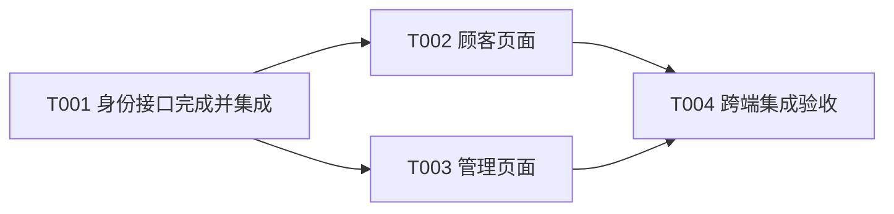

# 最小文档模板

先复用项目结构。没有约定时，小项目可将以下内容放入一份 `docs/development-plan.md`；任务较多时，将详细任务卡放入 `docs/tasks/Txxx.md`，主计划保留摘要与链接。审查证据直接链接现有报告，不重复复制。

这些模板用于按需填写，不要求一次创建全部文件。负责人、状态、日期等每个字段指定唯一维护位置，其余位置链接过去。

## 主计划

```markdown
# 项目开发计划

## 目标与范围

- 本期交付结果：
- 必做功能、涉及端与角色：
- 明确后置：
- 需求与设计来源：
- 当前需求版本与最近变更：
- 技术和项目约束：
- 验收环境与外部依赖／Mock 范围：
- 目标分支、集成负责人及交付方式：

## 需求覆盖

| 需求 ID | 来源 | 要求及验收去向 | Task | 决定 |
|---|---|---|---|---|

## 排期依据

- 目标日期、时区、工作日口径：
- 负责人和可用时间／并行容量：
- 估算依据、不确定项、验证及修复缓冲：
- 决定交付日期的依赖链：
- 功能冻结点：

## 任务总表

| Task | 交付结果／任务卡 | 负责人 | 前置 Task | 状态 | 当前预计完成 | 证据与 Git 记录 |
|---|---|---|---|---|---|---|

## 里程碑

| 里程碑 | 退出条件 | 原计划日期 | 当前预计 | 实际日期 | 偏差原因 |
|---|---|---|---|---|---|

## 分工与共享修改

| 负责人 | Task 范围 | 分支或工作目录 | 独占／共享修改范围 | 接口与集成约定 |
|---|---|---|---|---|

## 变更与决定

| 日期 | 来源 | 旧决定 → 新决定 | 影响 Task 与工期 | 决定人／依据 |
|---|---|---|---|---|

## 当前接续点

- 进行中：
- 可立即启动：
- 阻塞、解除条件与处理负责人：
- 最近完成的检查及证据：
- 当前分支、版本与未提交改动：
- 下一步：
```

## Task 卡

```markdown
# Txxx：可验收的交付结果

- 需求来源／父任务：
- 负责人；必要审查者；集成负责人：
- 目标与交付物：
- 本任务边界：
- 前置 Task、所需成果及完成证明：
- 接口约定、可修改范围、共享文件负责人：
- 分支／工作目录；目标分支：
- 验收环境／Mock 边界：
- 工作量估算与假设：
- 原计划开始／结束：
- 当前预计开始／结束；变更原因：
- 实际开始／结束：
- 状态；最近更新日期：

## 验收场景

| 场景 | 前置条件 | 操作 | 预期结果 | 实际结果／证据 |
|---|---|---|---|---|

## 审查与修复

| 版本与范围 | 审查者／方式 | 结论与问题 | 修复及复查证据 |
|---|---|---|---|

## Git 与集成

- 实现提交：
- 集成提交或目标分支对应记录：
- 必要的集成验证：
- 部署及部署后验证（仅适用时）：

## 阻塞与接续

- 原因、解除条件、处理负责人：
- 已尝试及结果：
- 下一步：
```

## 依赖与并行示例

以下使用虚构任务说明调度规则，不作为实际项目排期。



| 实际状态 | 可启动的工作 | 判断原因 |
|---|---|---|
| T001 已提交，尚未审查或集成 | 不启动 T002、T003 的依赖实现 | 提交不代表前置成果已可用 |
| T001 已完成并集成，两个页面修改范围和执行资源允许并行 | T002、T003 同时启动 | 两者前置条件都满足，互不等待 |
| T002 完成，T003 未完成 | T004 继续等待 | 多个前置条件必须全部满足 |
| T002、T003 都完成并集成 | T004 启动 | 跨端验收所需成果齐全 |
| T001 的接口被不兼容修改 | 复查 T002、T003；必要时重新打开相关 Task | 旧依赖证明失效，T004 不能沿用旧验收条件 |

如果页面静态布局确实能先做，可单独拆成不依赖身份实现的任务；其验收只覆盖静态布局，不能宣称登录或跨端业务已通过。

## 提交与进度示例

```text
docs(T001): 明确身份接口验收和依赖
feat(T001): 实现身份接口及权限验证
fix(T001): 修复审查发现的越权读取
docs(T001): 记录验收和集成结果
```

每条只是提交标题示例。实际 SHA 在提交后获取，后续记录可链接它；不能虚构 SHA 或要求提交包含自身 SHA。若最终采用 squash 合并，则记录目标分支中合并后的 SHA。

进度描述示例：“T001 已完成并集成，权限验证通过，证据见任务卡。T002、T003 已就绪；T004 等待两项完成。”只有调度工具或实际执行状态确认后，才能把“已就绪”改写成“已启动”。
